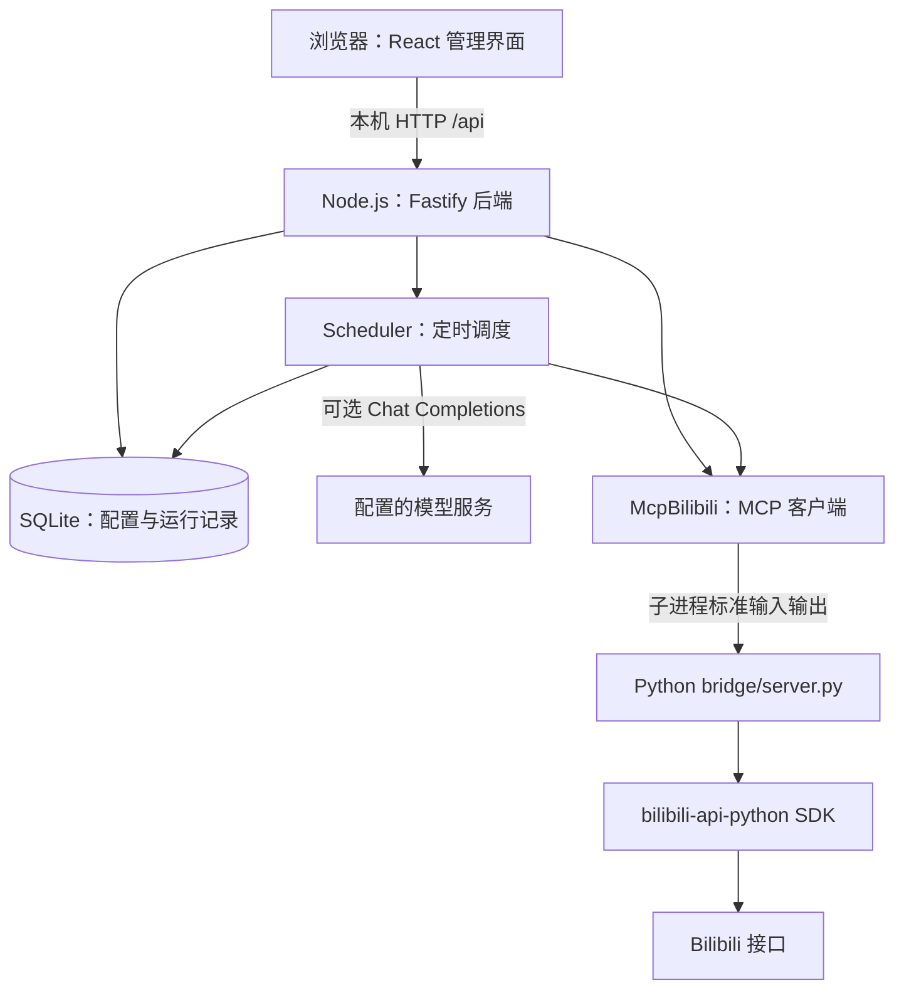

# Yui-bilibili 实现原理分析

分析日期：2026-10-14。版本：改造工作区；当前为未提交开发状态。

工作副本：`C:\Users\17076\Documents\B站自动检索`。

本报告依据源码、安装版启动脚本和现有回归测试。新工作区最初为空，已从此前部署的相同版本建立源码副本，Git origin 指向原 GitHub 仓库。对工作副本与安装版的 server、bridge、vendor 共 13 个文件进行了 SHA-256 比对，全部相同。没有把实际凭据、数据库、依赖或运行产物复制进新工作区。

## 1. 整体架构

它是一个在本机运行、用网页控制的定时巡逻程序。界面通过 HTTP 与 Node.js 服务交互；Node.js 决定什么时候搜索、如何筛选、是否互动；Python 进程执行 Bilibili 接口调用。AI 是可选的判断和撰写模块。



MCP 在这里是 Node 与 Python 通信的协议，不代表必须由 AI 选择工具。即使关闭 AI，调度器仍按代码规则调用同样的接口。

| 模块 | 实际职责 |
| --- | --- |
| `web/main.tsx` | 配置频道、模板、账号、模型，显示活动，操作总调度器 |
| `server/index.ts` | 创建 Store、MCP 客户端、Scheduler、Fastify，监听端口 |
| `server/app.ts` | HTTP 接口、输入校验、本机访问守卫、静态页面服务 |
| `server/model.ts` | 前后端共用的数据结构、默认值和基础过滤规则 |
| `server/scheduler.ts` | 搜索、分流、队列消费、等待、额度、暂停和错误退避 |
| `server/store.ts` | SQLite 建表、存取、去重、运行状态与启动恢复 |
| `server/bilibili.ts` | 启动 Python MCP 子进程，封装工具调用并校验返回数据 |
| `server/ai.ts` | 模型请求、判断、撰写和输出词法检查 |
| `server/auth.ts` | 解析并保存手动输入的 Cookie |
| `bridge/server.py` | SDK 适配、登录扫码与续期、串行化、写锁、错误脱敏 |
| `vendor/bilibili-mcp/` | 固定版本的上游 MCP 工具源码 |

## 2. 点击快捷方式后发生什么

安装版位于 `%LOCALAPPDATA%\Programs\Yui-bilibili`，快捷方式调用其中的 `Start-Yui-Bilibili.ps1`。

1. 检查 3217 端口是否已有监听者。
2. 若没有，设置 `DATA_DIR`、`PYTHON` 和 `BILIBILI_WRITES_ENABLED=true`。
3. 隐藏启动安装目录自带的 `runtime/node.exe build-server/index.js`。
4. 请求 `/api/health`，等待服务可访问，再打开默认浏览器。
5. Node 初始化数据库、创建 Python 客户端和调度器，监听 `127.0.0.1:3217`。
6. 调度器启动每秒一次的本地检查计时器，但总巡逻状态被强制设为暂停。
7. 首次登录检查触发 MCP 连接时，Node 才启动 Python 子进程；连接随后持续复用。

`dist/` 是 Vite 构建出的网页；`build-server/` 是 TypeScript 编译出的服务程序。正式运行无需开发服务器。

浏览器关闭不会在代码中触发停止服务。服务能否持续工作取决于 Node 和 Python 进程是否存活；后台进程没有配置自动崩溃重启，也没有注册成 Windows 服务。此前用 Codex 前台终端启动时，运行生命周期随终端而结束。

安装脚本只是后台启动器。它按端口判断“已启动”，没有校验该监听进程是否属于本项目。停止脚本按端口定位 PID 并强制终止进程树，也没有项目身份校验。这是后续完善启动管理时应处理的点。

安装目录虽然带有 Node 可执行文件和 Python 虚拟环境，Python 虚拟环境仍引用本机的基础 Python，因此整套安装目录不保证能直接复制到另一台未安装 Python 的电脑运行。

## 3. 网页与服务如何交互

React 用 `fetch('/api…')` 调用同一服务。总览状态每 5 秒刷新一次，登录二维码每次请求结束后等待 2 秒再查询状态。活动记录页只在进入页面、改变筛选或翻页时加载，并没有定时刷新活动表。

主要 API：

| 接口 | 用途 |
| --- | --- |
| `GET /api/health` | 进程健康与版本信息 |
| `GET /api/state` | 公共配置、频道、模板、统计、最近成功评论、队列数量 |
| `/api/topics`、`/api/templates` | 创建、编辑和删除频道或模板 |
| `GET /api/activity` | 活动记录，按类型筛选和分页 |
| `PUT /api/limits` | 保存全局额度与等待范围 |
| `/api/ai/settings`、`/api/ai/check` | 保存模型配置与检查模型连接 |
| `POST /api/scheduler` | 启动或暂停总巡逻 |
| `/api/account/*` | 登录检查、Cookie 登录、扫码与退出 |
| `GET /api/tools` | 枚举 MCP 工具；此接口不执行任意工具 |

输入由 Zod 校验。服务检查 Host，并限制有 Origin 的修改请求来源；默认只监听本机。它没有多用户账号认证。

## 4. 搜索如何执行

入口是 `Scheduler.discover()`。所谓“频道”是用户配置的一组关键词和规则，搜索不绑定某个 B 站分区。

每秒的 tick 只检查任务是否到期，不会每秒访问 B 站。`active` Promise 防止两轮调度重叠；到期频道依次执行，Python 桥接另有全局锁串行化工具调用。

每次到期：

1. 检查全局及本频道当日搜索次数；达到额度后，将下次搜索安排到上海时间下一天。
2. 通过“该频道今天搜索次数 % 关键词数量”选择一个关键词。因此每个搜索周期只搜索一个关键词；关键词轮转每天重新从第一项开始。
3. 按频道的最小、最大间隔随机计算下次搜索时间。
4. 先记录一次 search 活动，再调用搜索，所以搜索失败也会占搜索额度。
5. Python 调用 `search.search_by_type()`：视频类型、`page=1`、最多 50 条、播放量降序 `click`。
6. SDK 接受整日日期范围；桥接把日期范围向外扩到整天，Node 再用精确时间窗裁剪。
7. Node 只在视频标题上做本地关键词匹配；UP 主名称、发布时间和播放量不参与资格过滤。

当前版本不使用最低/最高播放量或发布时间窗口做过滤；这些字段只作为平台返回的视频元数据保存。

这是周期性单页抽样检索：它不会自动翻到第二页，也不会下载或观看视频。即使符合条件的视频很多，单次候选仍限于第一页最多 50 条。

## 5. 去重与分流

符合机械条件的视频先写入 `discoveries`。SQLite 使用 BV 主键与 AV 唯一约束，通过 `INSERT OR IGNORE` 阻止同一个视频跨频道、跨关键词、跨重启重复进入处理流程。

只有标题命中关键词的视频才写发现记录并建立计划；仅 UP 主名称命中的视频不匹配、不持久化。

不匹配视频不写发现记录；播放量和发布时间字段不会改变资格。

自动巡逻不调用 AI。每个本地匹配视频在入池时按 70% 延后、20% 评论、10% 回复固定动作，重启和重试不重新抽签。

AI 开启时，调用一次 `OpenAiPatrol.judge()`，概率字段不参与分流。模型返回 `skip`、`comment`、`reply` 或 `uncertain`，其中 uncertain 按 skip 处理。判断失败也跳过，不回退随机分流。

决定评论或回复后，只创建 `queued` 记录并设置随机到期时间，发现阶段不会立即发出评论。

## 6. 互动队列如何发送

`Scheduler.interact()` 每轮最多消费一个到期任务，按 `due` 和 `id` 排序。

1. 检查互动退避时间、全局下次允许互动时间，以及距离上次尝试的最小间隔。
2. 读取最新频道，确认启用和 AI 配置有效。
入池后只使用计划快照、模板快照和当前账号/额度状态复核，不重复执行旧的时间或播放量过滤。
4. 检查全局总互动、全局评论/回复，以及频道评论/回复额度。
5. 额度耗尽时延后到下一天；此时不会发送，也不会占用新的尝试额度。
6. 选择正文：从入池时保存的评论或回复模板快照中选择，正文与上一条相同则等待可用模板。
7. 回复模式读取第一页按点赞排序的普通根评论，自动路径请求最多 30 条。
自动巡逻不调用 AI。每个本地匹配视频在入池时按 70% 延后、20% 评论、10% 回复固定动作，重启和重试不重新抽签。
9. 所有异步准备完成后，立即再检查登录、暂停代次、最新额度、间隔、频道设置和模板有效性。
10. 将 queued 更新为 claimed，保存尝试时间、正文和目标显示名，并持久化下一次允许互动时间。
11. 调用 `bili_reply`：`rpid=0` 发布新视频评论；`rpid>0` 回复目标根评论，设置对应 root/parent。
12. 根据结果标为 succeeded 或 failed，记录活动；成功回执附新评论 ID、视频封面及当时统计信息。

模板正文上限为 300 个 UTF-16 字符。模板路径没有经过 `safeAiText()` 那套 AI 输出词法检查，主要做有效性与连续相同内容检查；模板内容需要由使用者自行保证合适。

额度按持久化尝试时间统计，已经尝试但失败的发送同样占额度。界面“今日评论/回复”来自成功活动统计，频道“今日互动”来自尝试次数，所以两者可能不同。

## 7. 防重复发送与启动恢复

互动状态主要为：

```text
queued → skipped
queued → claimed → succeeded
                 → failed
                 → uncertain（进程在确认结果前停止，重启恢复）
```

claimed 是先落盘再发送的标记。如果网络已收到请求而本地没有收到响应，本地无法确认是否发送成功。启动时数据库事务把遗留 claimed 改为 uncertain，并补写不确定活动；这类视频不会自动重发。

它优先避免本地重复尝试，代价是可能漏发；它不能保证平台端“恰好执行一次”。失败记录代表本地调用失败，不一定能证明远端没有产生评论。

`generation` 是暂停/重新启动时递增的代次。网络返回后代码检查当前代次和 running，防止旧调用继续产生新互动。暂停会等待当前轮结束；已经发到网络上的请求无法撤回。

## 8. AI 实际获得什么信息

判断阶段只给模型频道名称、关键词、标题和 UP 主；不提供视频画面、字幕、弹幕或音频。

撰写阶段额外给出用户配置的风格，以及回复候选的 rpid 和正文。模型不会拿到 B 站 Cookie、账号凭证、候选 UID 或整份本地配置。

模型调用采用兼容 Chat Completions 的 HTTP 接口，代码只追加一次 `/chat/completions`，不会自动补 `/v1`。API key 只用于对模型服务的 Authorization 请求头。

巡逻请求参数包括 JSON mode、temperature 0.2 和 max_tokens 4096。单次请求超时 12 秒，响应上限 16 KiB，只接受 `finish_reason=stop`，不跟随重定向、不自动重试。仅取 `choices[0].message.content`，不使用推理字段。

输出原因上限 80、正文上限 120 个 UTF-16 字符。JSON 结构、回复 ID 和词法检查必须通过，正文与上一条完全相同时也不能发送。词法检查使用 NFKC 规范化及正则，检查链接、域名、联系方式、广告、辱骂、疑似凭据等；它不是完整语义审核。

自动巡逻不调用 AI；旧频道 AI 字段仅为兼容读取，独立模型连接能力仍可保留。

## 9. 登录、SDK 与写锁

Python 桥接导入固定上游源码，替换登录、搜索、读评论、发送等六个关键实现，再为 27 个工具统一加包装。

自动巡逻只使用 `bili_check_credential`、`bili_search`、`bili_comments` 和 `bili_reply`。字幕、弹幕、私信、上传等其余工具没有接入自动调度。

扫码由 B 站网页二维码接口完成；二维码图片在内存生成，前端只显示并轮询。确认成功后同时从响应 Cookie 和 URL 参数取得登录字段，只有必需字段完整时才原子替换凭据。手动 Cookie 登录由 Node 解析和保存，再请求登录验证。

登录检查调用账号自身端点 `user.get_self_info()`，而非查询公开个人主页。保存了刷新令牌时，Python 桥接最多每 12 小时检查是否需要续期并调用 SDK 刷新。

即使总巡逻暂停，启动后的首次 tick 和之后每 12 小时也会检查登录；暂停状态检查失败后 5 分钟再试，因此“暂停”不等于完全离线。运行时在任务到期或每 5 分钟检查登录，发送前还会再次检查。

真实写开关有两道限制：HTTP 层在开关关闭时拒绝启动总巡逻；Python 层逐个拦截写工具。仅环境变量字符串严格等于 `true` 才开启，程序不自动读取 `.env`。

因此当前没有可以直接启动的独立“写锁关闭、只做检索”的调度模式，即使频道跳过概率为 100%，HTTP 启动接口仍要求开关开启。这是功能实现上的耦合。

直接使用 MCP 写工具不经过网页巡逻额度和持久化队列，仅经过桥接写锁与串行锁；它和自动巡逻的保证范围不同。

## 10. 数据存在哪里

安装版数据目录是 `%LOCALAPPDATA%\Yui-bilibili\data`。

| 存储位置/表 | 内容 |
| --- | --- |
| `config/bili_credential.json` | Cookie 和可选刷新令牌 |
| `patrol.sqlite` | 配置、调度与互动记录 |
| `topics` / `keywords` | 频道配置、关键词、下次搜索时间 |
| `templates` | 绑定频道的评论和回复模板 |
| `discoveries` | 视频 BV/AV、发现信息、来源与去重 |
| `interactions` | 动作、状态、到期/尝试时间、正文、目标与回执 |
| `activity` | 搜索、发现、判断、排队、跳过、发送和错误记录 |
| `app_settings` | 总调度状态、全局限额、等待信息、模型配置及 key |
| `auth_metadata` | 登录状态、用户名、UID 与续期状态，不含 Cookie |
| `logs/` | 安装版启动输出和错误日志 |

SQLite 使用 WAL、外键和 5 秒 busy_timeout，频道保存和启动恢复使用事务。旧数据库缺少 target 或 receipt 字段时会补齐。

前端拿到的模型配置只有根地址、模型名和 `apiKeyConfigured`，不回显 key。磁盘上的 Cookie 和 key 仍是明文；POSIX mode 权限设置在 Windows 上不能等同于有效的 NTFS ACL 防护。

## 11. 已确认的实际限制

- 单账号、单机、单 Node 服务实例的设计，没有多账号调度或多用户权限体系。
- 单次只取一个关键词的第一页，播放量排序可能使高播放视频反复占据第一页，不能覆盖全部匹配视频。
- 去重是持久全局的，跳过也留下记录；没有自动“重新考虑已跳过视频”的逻辑。
- 入池后不复核发布时间或播放量；只复核计划版本、账号 UID、频道状态、模板、间隔和额度。
- AI 看不到视频本身，标题不足时可能判断不准或保守跳过。
- 搜索创建计划与互动执行分离；计划账本和写尝试账本分别持久化。
- 读请求和互动有不同失败计数，但 readRetryAt 生效时整个 cycle 提前返回，也会暂缓互动消费。
- 读和互动错误按 1、2、4…分钟退避，代码封顶 1 小时；默认任一连续失败达到 3 次会自动暂停，登录/风控/写锁错误则立即暂停。
- 没有可用模板、正文连续重复、找不到安全回复候选、AI 输出不合格、额度用尽等均可能导致没有互动；额度是上限而非目标。
- 运行状态启动时强制暂停；重新启动程序不等于恢复巡逻。
- 非官方 B 站 SDK 和平台接口是外部兼容性依赖；健康接口成功不能证明搜索、登录或发送已经在真实平台上验收成功。
- 快捷方式操作普通后台进程，没有自动重启和 Windows 服务管理；当前复制式安装也不是跨机器可移植安装包。

## 12. 本次验证与后续修改入口

本次运行已有 `scheduler.test.ts`、`ai.test.ts`、`mcp.test.ts`，共 55 项，全部通过。复用了原部署工作副本中的 Node 依赖和测试文件，在新工作区运行，并为 MCP 指定安装版 Python。测试进程显式设置 `BILIBILI_WRITES_ENABLED=false`；业务测试使用 Fake Bilibili、loopback 假模型和临时/内存 SQLite；MCP 测试仅启动子进程枚举工具。

这是针对核心行为的回归验证，没有在本次重新跑完整 lint、build、账号测试或所有 Python 回归，也没有做真人登录、真实 B 站发送或实际模型供应商验收。本次没有改变业务源码、现有安装启动参数、账号数据或运行中的服务。

后续要修改检索范围与排序，应同时检查 `server/bilibili.ts`、`bridge/server.py` 和 `server/scheduler.ts`；调整 AI 策略主要改 `server/ai.ts`；更改额度、队列和防重需联动 scheduler、store 及现有测试；更改网页表单需保持 model 的共享 schema 一致。

当前新工作区是分析与开发用源码，桌面快捷方式仍指向 AppData 中的安装版。修改新工作区的 TypeScript/React 不会自动更新安装版；应用变更需要另行安装依赖、构建并部署产物。
